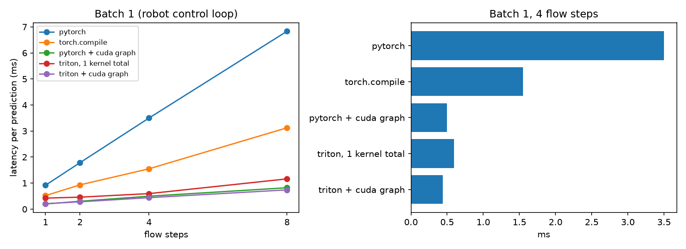

# flashflow-vla

Triton kernels that run the flow-matching action head of RosVLA in a single GPU launch.

RosVLA generates a small text latent with a rectified-flow head before it predicts the robot's next
commands. Each flow step is a stack of tiny layers (linear, LayerNorm, FiLM, SiLU), so in PyTorch the
GPU spends most of its time waiting for the next kernel launch. Here the whole sampling loop
(all steps, all blocks) runs inside one Triton kernel, and the time conditioning is precomputed
since it never depends on the input.

## Results



**Same answers.** On all 10 RosVLA held-out scenarios (211 robot decisions), the Triton version gives the
same numbers as PyTorch to within 0.0000006, picks the same action every single time, and gets the
same accuracy (75.8%) and command error. Nothing about the model's behaviour changes, only its speed.

**Much faster.** One full prediction (camera frame and past commands in, next 6 commands out), batch 1, 4 flow steps:

| | time per prediction | speed-up | jobs sent to the GPU |
|---|---|---|---|
| PyTorch | 3.50 ms | 1x | 226 |
| torch.compile | 1.55 ms | 2.3x | 107 |
| PyTorch + CUDA graph | 0.50 ms | 7.0x | 1 |
| **Triton, one kernel** | **0.60 ms** | **5.9x** | **19** |
| **Triton + CUDA graph** | **0.44 ms** | **8.0x** | **1** |

That is roughly 290 decisions per second before and about 2,300 after.

What the numbers say:

- **The model was never slow at math, it was slow at asking.** PyTorch sends the GPU 226 tiny jobs per
  decision, and the GPU spends most of its time waiting for the next one. Putting the whole sampling loop
  in one kernel cuts that to 19, and the 19 left are the small layers around the flow head.
- **Extra flow steps become almost free.** Each additional step costs about 0.85 ms in PyTorch but only
  about 0.1 ms inside the kernel (left plot: the blue line climbs, the red one barely moves). More steps
  usually means better samples, so this changes what is affordable on a robot.
- **CUDA graphs are a strong alternative at batch 1, and the kernel holds up better as the batch grows.** Recording
  the 226 jobs and replaying them gets close to the kernel for a single robot. At batch 256 the graph is
  only 3.4x faster than PyTorch, while the kernel stays at 5x, and 6.5x with a graph on top, because it does
  less work, not just fewer launches. The two combine, and together they are the fastest in every setting except a single flow step.
- **Fusing each step separately already helps (4.5x), but fusing the whole loop helps more (5.9x)**, since the
  numbers never leave the chip between steps.
- **TF32 does not help here.** The matrices are too small for faster multiplication to matter. The bottleneck
  was the waiting, and that is what this project removes.

Timings are the median of 1,000 runs on one NVIDIA GPU under WSL2, using real RosVLA frames. The frozen image
encoder is not included, since its features are computed once per frame and cached. Full numbers are in
`results/bench.csv` and `results/eval.json`.

## Setup

Linux or WSL2 (needs only the NVIDIA driver on Windows, check with `nvidia-smi`):

```bash
python3 -m venv .venv && source .venv/bin/activate
pip install torch
pip install -r requirements.txt
```

On native Windows, install PyTorch with CUDA from [pytorch.org](https://pytorch.org/get-started/locally/)
first; `requirements.txt` then installs `triton-windows`.

## Data

The RosVLA dataset is available at https://huggingface.co/datasets/ell-hosse/RosVLA.
Put it in the project like this:

```
dataset/annotations/*.json
dataset/data/*.h5
checkpoints/fold_*/model.pt     # trained RosVLA velocity-head models, one per fold
cache/img_mobilenet_v3_small_224.npz
```

If you don't have the image feature cache, build it with `python features.py`.

## Run

```bash
python test.py    # Triton output == PyTorch output, for every fold
python eval.py    # same commands and actions on the held-out RosVLA scenarios
python bench.py   # latency: PyTorch, torch.compile, CUDA graphs, Triton
python plot.py    # results/latency.png
```

## Files

- `model.py` the RosVLA velocity-head model, same as in the paper
- `kernel.py` the fused Triton kernel and `FusedSampler`, a drop-in for `FlowHead.sample`
- `data.py` loads the RosVLA test windows for each fold
